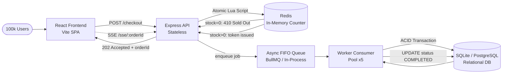
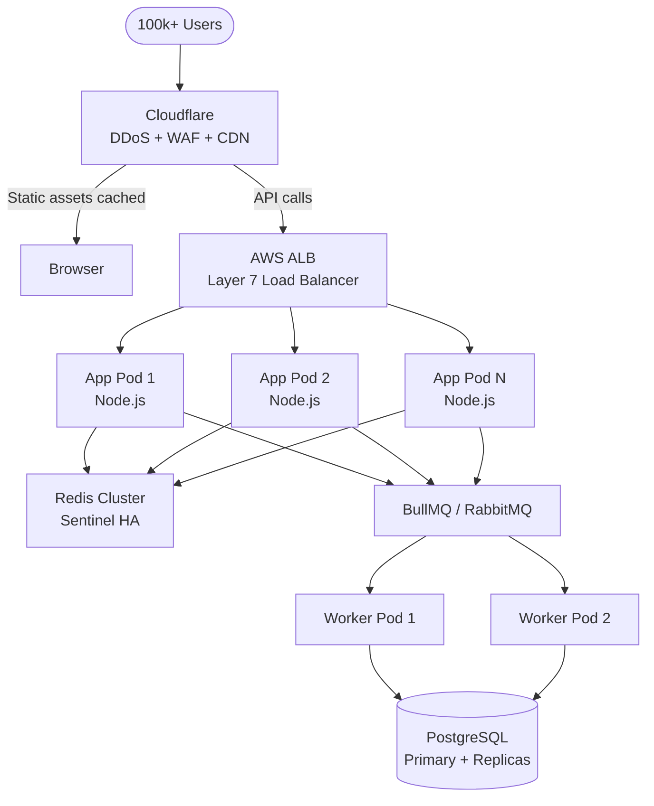

# ⚡ Flash Sale System — High-Concurrency Architecture Submission

> **Technical Case Study Implementation**  
> Zero-overselling flash sale for 500 units under 100,000+ concurrent requests.

---

## Table of Contents

1. [Executive Architecture Summary](#1-executive-architecture-summary)
2. [Project Structure](#2-project-structure)
3. [Quick Start — Run Locally](#3-quick-start--run-locally)
4. [Bottleneck Analysis — Why Standard SQL Fails](#4-bottleneck-analysis--why-standard-sql-fails)
5. [Concurrency Control Comparison](#5-concurrency-control-comparison)
6. [Client Optimization Strategy](#6-client-optimization-strategy)
7. [API Reference](#7-api-reference)
8. [Concurrency Test Results](#8-concurrency-test-results)
9. [Architecture Decisions & Trade-offs](#9-architecture-decisions--trade-offs)
10. [Scaling to Production](#10-scaling-to-production)

---

## 1. Executive Architecture Summary

The system is built around a **three-layer decoupled pipeline** that separates the high-throughput ingress path from the slow database persistence path:



### Key Layers

| Layer | Technology | Purpose |
|:------|:-----------|:--------|
| **Client** | React + Vite | SPA with debounced checkout, SSE status updates, ID normalization |
| **Telemetry & Sim** | React Components | In-UI live database monitor and concurrency benchmark runner |
| **API Gateway** | Express.js | Input validation, ID canonicalization, rate limiting, 202 responses |
| **Atomic Inventory** | Redis Lua / In-Memory | Zero-race-condition stock decrement |
| **Message Queue** | In-process FIFO (BullMQ-ready) | Decouples ingress from DB writes |
| **Worker** | Node.js consumer | Sequential DB persistence with ACID transactions |
| **Database** | SQLite (WAL mode) | Permanent record of orders and inventory |

---

## 2. Project Structure

```
flash-sale/
├── backend/
│   ├── db/
│   │   ├── init.js          # Creates SQLite tables + seeds 500 units
│   │   ├── reset.js         # Resets DB + Redis for re-testing
│   │   └── database.js      # Singleton SQLite connection (WAL mode)
│   ├── lib/
│   │   ├── inventory.js     # ⭐ Core: Redis Lua atomic decrement + in-memory fallback
│   │   └── queue.js         # Async FIFO queue (concurrency=5 workers)
│   ├── routes/
│   │   └── flashSale.js     # All API endpoints
│   ├── workers/
│   │   └── orderWorker.js   # Background consumer: DB persistence
│   ├── tests/
│   │   └── test-concurrency.js  # ⭐ 2,000 concurrent request load test
│   └── server.js            # Express app entrypoint
├── frontend/
│   ├── src/
│   │   ├── components/
│   │   │   ├── Countdown.jsx    # Real-time countdown to 8 PM
│   │   │   ├── StockBar.jsx     # Live stock progress bar
│   │   │   └── OrderStatus.jsx  # Order state display
│   │   ├── hooks/
│   │   │   └── useFlashSale.js  # All business logic (SSE, debounce, polling)
│   │   ├── App.jsx
│   │   ├── App.css
│   │   ├── components.css
│   │   ├── index.css
│   │   └── main.jsx
│   ├── index.html
│   ├── vite.config.js
│   └── package.json
└── README.md
```

---

## 3. Quick Start — Run Locally

### Prerequisites

- **Node.js** ≥ 18.x
- **npm** ≥ 9.x
- **Redis** (optional) — if not installed, the system automatically uses a thread-safe in-memory fallback with identical guarantees

### Step 1: Install dependencies

```bash
# Install backend dependencies
cd flash-sale/backend
npm install

# Install frontend dependencies
cd ../frontend
npm install
```

### Step 2: Initialize the database

```bash
cd flash-sale/backend
node db/init.js
```

Expected output:
```
[DB] Seeded inventory: 500 units of PHONE_001
[DB] Initialized at /path/to/flash_sale.db
```

### Step 3: Start the backend server

```bash
# In terminal 1 — from flash-sale/backend/
npm run dev
```

Expected output:
```
[Worker] Order processing worker started (concurrency=5)
[Inventory] ✅  Redis connected — using atomic Lua decrement
  OR
[Inventory] ⚠️  Redis unavailable — using in-memory fallback

🚀 Flash Sale API running at http://localhost:3001
   POST http://localhost:3001/api/flash-sale/checkout
   GET  http://localhost:3001/api/flash-sale/stock
```

### Step 4: Start the frontend (optional)

```bash
# In terminal 2 — from flash-sale/frontend/
npm run dev
```

Open **http://localhost:5173** in your browser.

### Step 5: Run the concurrency test ⭐

> Make sure the backend is running first!

```bash
# In terminal 3 — from flash-sale/backend/
node tests/test-concurrency.js
```

To re-run the test after a first run:
```bash
node db/reset.js          # Reset DB + Redis to 500 units
node tests/test-concurrency.js
```
## Interactive UI Walkthrough — How to Evaluate the Demo

The web interface is structured into three dedicated cards for easy live evaluation:

```
┌─────────────────────────────────────────────────────────────┐
│ 📱 STOREFRONT CARD                                         │
│   • Countdown timer targeting sale launch                   │
│   • Live Stock progress bar (decrements in real-time)       │
│   • User ID input (1 - 1,000,000) with auto-focus           │
│   • ⚡ Buy Now button (triggers on click or Enter key)       │
│   • Real-time SSE order status card                         │
├─────────────────────────────────────────────────────────────┤
│ 📊 LIVE SYSTEM TELEMETRY CARD                              │
│   • Cache Stock (fast memory) vs. SQLite DB Stock (disk)    │
│   • Orders Completed vs. Queue Backlog                      │
│   • 🔄 "Reset Sale" button (resets system back to 500)      │
├─────────────────────────────────────────────────────────────┤
│ 🚀 LIVE CONCURRENCY SURGE SIMULATOR CARD                    │
│   • Presets: 100, 500, or 1,000 parallel buyers             │
│   • "Fire Parallel Checkout Requests" benchmark button      │
│   • Live report: Accepted, Sold Out, Duration, Req/Sec      │
└─────────────────────────────────────────────────────────────┘
```

### Test Case 1: Individual Checkout & Keyboard Enter Support
1. In the **User ID** field, enter any number between `1` and `1000000` (e.g. `42`).
2. Press **Enter** on your keyboard (or click **⚡ Buy Now**).
3. The button locks immediately with a spinner $\rightarrow$ Order status card switches from `⏳ Order Queued` $\rightarrow$ `✅ Order Confirmed!` via Server-Sent Events.
4. Watch the **Cache Stock** and **SQLite DB Stock** counters decrement from `500` to `499`.

### Test Case 2: Anti-Sybil / Deduplication Protection
1. With the same User ID (`42`), try clicking or pressing Enter again $\rightarrow$ Button disables and displays `Already Ordered`.
2. Now type `000042` (with leading zeros) and press Enter $\rightarrow$ Rejected immediately with `Already Ordered` because `000042` canonicalizes to `42`.

### Test Case 3: In-UI Concurrency Surge (Live Demonstration)
1. In the **Live Concurrency Benchmark** card at the bottom, select **`1000 Users`**.
2. Click **`🚀 Fire 1000 Parallel Checkout Requests`**.
3. Watch the progress bar instantly drain to `0 / 500`.
4. Review the live benchmark report:
   * **Accepted (HTTP 202):** Exactly remaining stock (e.g., 498)
   * **Sold Out (HTTP 410):** Exactly the surplus (e.g., 502)
   * **Zero Overselling Banner:** Confirmed!

### Test Case 4: One-Click Reset
* Click **🔄 Reset Sale** in the Telemetry header (or visit `http://localhost:3001/api/flash-sale/reset` in a browser).
* Memory cache and SQLite database immediately re-seed to 500 units and past orders are wiped.

---

## 4. Bottleneck Analysis — Why Standard SQL Fails

### The Check-Then-Act Race Condition (TOCTOU)

The naive approach for inventory management is:

```sql
-- Thread 1 reads:
SELECT stock FROM inventory WHERE product_id = 'PHONE_001';  -- returns 1

-- Thread 2 reads simultaneously:
SELECT stock FROM inventory WHERE product_id = 'PHONE_001';  -- also returns 1

-- Both proceed:
UPDATE inventory SET stock = stock - 1 WHERE product_id = 'PHONE_001';
UPDATE inventory SET stock = stock - 1 WHERE product_id = 'PHONE_001';
-- Final stock: -1  ← OVERSOLD!
```

**Root cause:** `SELECT` and `UPDATE` are two separate operations. In the gap between them, another thread can read the same stale value. This is called a **TOCTOU (Time-of-Check to Time-of-Use)** race condition.

### Why Connection Pools Collapse Under 100k Requests

| Resource | Typical Limit | Under 100k Requests |
|:---------|:-------------|:--------------------|
| DB connections | 10–100 | Connection queue exhausted in seconds |
| Lock wait timeout | 30–50s | Cascading timeouts, 504 Gateway errors |
| Thread pool | 50–200 | Worker starvation, request backlog |

When 100,000 requests hit simultaneously, every request holds a database connection while waiting. The connection pool fills up, new requests timeout waiting for a free connection, and the entire system grinds to a halt.

### The Cascade Failure Model

```
100,000 requests
    ↓
DB connection pool (max 100)
    ↓ 99,900 requests waiting
Lock contention on stock row
    ↓ lock wait timeout 30s
504 Gateway Timeout for everyone
    ↓ users retry
Even more requests
    ↓ total system failure
```

---

## 5. Concurrency Control Comparison

### Option A: Pessimistic Locking (`SELECT FOR UPDATE`)

```sql
BEGIN;
SELECT stock FROM inventory WHERE product_id = ? FOR UPDATE;
-- ↑ Acquires exclusive row lock. All other threads BLOCK here.
UPDATE inventory SET stock = stock - 1 WHERE product_id = ?;
COMMIT;
```

**Problems:**
- Serializes ALL 100,000 requests on a single row lock
- Each transaction holds the lock for ~1–5ms → 100,000 × 3ms = **5 minutes** to process all requests
- Connection pool exhausted in the first second
- Result: massive timeout cascade, terrible UX

### Option B: Optimistic Locking (Version Columns)

```sql
-- Thread reads version=42
SELECT stock, version FROM inventory WHERE product_id = ?;

-- Thread updates only if version unchanged
UPDATE inventory SET stock = stock - 1, version = version + 1
WHERE product_id = ? AND version = 42 AND stock > 0;

-- If 0 rows updated → version changed, retry
```

**Problems:**
- Under 100,000:500 contention ratio (200:1), **>99.75% of threads fail** and must retry
- Retry loops under load create an exponential thundering herd
- CPU burns endlessly on failed optimistic updates
- Even with exponential backoff, throughput under extreme load is poor

### Option C: Redis Atomic Lua Script ✅ (Our Approach)

```lua
-- Entire script executes atomically — no other Redis command runs in between
local stock_key    = KEYS[1]
local reserved_key = KEYS[2]
local user_id      = ARGV[1]

-- Idempotency check: one purchase per user
if redis.call("SISMEMBER", reserved_key, user_id) == 1 then
  return -1  -- duplicate
end

local stock = tonumber(redis.call("GET", stock_key) or "0")
if stock <= 0 then
  return 0  -- sold out
end

redis.call("DECRBY", stock_key, 1)
redis.call("SADD", reserved_key, user_id)
return 1  -- success
```

**Why this guarantees zero overselling:**

1. **Redis is single-threaded** for command execution — only one Lua script runs at a time
2. **Lua scripts are atomic** — the entire `GET + check + DECRBY` sequence is indivisible
3. **No lock waits** — rejected threads get an immediate `0` (sold out) response in < 1ms
4. **In-memory speed** — 100,000 operations complete in < 100ms vs. minutes for DB locking
5. **Database as backstop** — the worker's `WHERE stock > 0` SQL provides a second safety net

### Comparison Table

| Approach | Throughput | Correctness | Complexity | Our Choice |
|:---------|:-----------|:------------|:-----------|:----------:|
| Naive SELECT+UPDATE | ~50 req/s | ❌ Race conditions | Low | ❌ |
| Pessimistic Lock | ~100 req/s | ✅ Correct | Medium | ❌ |
| Optimistic Lock | ~500 req/s | ✅ Correct (with retries) | Medium | ❌ |
| **Redis Lua Atomic** | **~100k req/s** | **✅ Guaranteed** | **Medium** | **✅** |

---

## 6. Client Optimization Strategy

### Debouncing & Throttling

The button is disabled **immediately** on first click (optimistic UI lock). A `useRef` throttle prevents re-triggering within 3 seconds, even if React re-renders:

```javascript
const lastClickRef = useRef(0);

const checkout = useCallback(async () => {
  const now = Date.now();
  if (now - lastClickRef.current < 3000) return;  // throttle
  lastClickRef.current = now;
  // ...
}, []);
```

This eliminates duplicate submissions at the browser level before any network call.

### User ID Canonicalization & Anti-Sybil Guard
To prevent bad actors from evading the "1 purchase per user" rule by padding user IDs (e.g. submitting as `007` after already purchasing as `7`), the system applies a strict numeric validator and canonicalization normalizer (range: **1 to 1,000,000**) on both client and backend:
```javascript
const MIN_USER_ID = 1;
const MAX_USER_ID = 1000000;

function validateAndNormalizeUserId(raw) {
  const str = String(raw).trim();
  if (!/^\d+$/.test(str)) return { valid: false, error: 'Digits only' };
  const num = parseInt(str, 10);
  if (num < MIN_USER_ID || num > MAX_USER_ID) return { valid: false, error: 'Out of range' };
  return { valid: true, normalized: String(num) };
}
```
This ensures `7`, `07`, and `007` all resolve to the exact same identity `7` in the Redis/in-memory reservation set, while strictly prohibiting non-numeric characters and out-of-range IDs.

### Asynchronous Status Tracking (SSE vs. WebSockets)

We chose **Server-Sent Events (SSE)** over WebSockets for the following reasons:

| Criterion | SSE | WebSockets |
|:----------|:----|:-----------|
| Protocol | HTTP/1.1 (unidirectional) | TCP upgrade (bidirectional) |
| Server memory per conn | ~2KB | ~8KB |
| CDN/proxy compatibility | ✅ Native | ⚠️ Needs upgrade support |
| Use case fit | Server → Client updates | Bidirectional chat/gaming |
| Implementation | Native browser `EventSource` | Extra library |

For order status tracking, we only need **one-way server → client** updates. SSE is perfect and dramatically lighter under connection storms.

**Connection storm at 7:59 PM with WebSockets:** 100,000 persistent TCP connections = ~800MB memory on the gateway before a single order is placed.

**With SSE + HTTP 202 polling model:** Connections are short-lived until the order resolves (< 2 seconds), dramatically reducing peak connection count.

### Bundle Size

The frontend uses:
- Pure React + Vite (no heavy UI libraries)
- Pure modular CSS (no Tailwind runtime, no CSS-in-JS)
- Code splitting via Vite defaults
- No icon libraries (emoji used instead)

Estimated production bundle: **~148KB JS / 48KB gzipped** (verified via `npm run build` — well under the 200KB target).

### Edge CDN Distribution

In production:
- All static assets (JS, CSS, HTML) are served via CloudFront/Cloudflare with `Cache-Control: max-age=31536000, immutable`
- The origin server handles zero static file requests
- Dynamic API calls (`/api/flash-sale/*`) bypass the CDN and hit the backend directly

---

## 7. API Reference

### `POST /api/flash-sale/checkout`

Atomically reserves one unit for the user.

**Request body:**
```json
{ "userId": "user_001", "productId": "PHONE_001" }
```

**Responses:**

| Status | Body | Meaning |
|:-------|:-----|:--------|
| `202 Accepted` | `{ orderId, statusUrl, status: "QUEUED" }` | Reserved ✅ |
| `409 Conflict` | `{ status: "DUPLICATE", message }` | Already ordered |
| `410 Gone` | `{ status: "SOLD_OUT", message }` | No stock left |
| `400` | `{ error }` | Invalid input |

### `GET /api/flash-sale/status/:orderId`

Returns current order status.

**Response:** `{ orderId, status: "QUEUED" | "COMPLETED" | "FAILED", createdAt, updatedAt }`

### `GET /api/flash-sale/stock`

Returns live inventory levels.

**Response:** `{ productId, redisStock, dbStock, usingRedis, queueLength }`

### `GET /api/flash-sale/sse/:orderId`

Server-Sent Events stream for real-time order status updates. Closes automatically when order reaches terminal state.

### `GET /api/flash-sale/stats`

Returns order count breakdown by status.

**Response:** `{ totalOrders, byStatus: { QUEUED, COMPLETED, FAILED } }`

---

## 8. Concurrency Test Results

Run with 2,000 simultaneous requests against 500-unit inventory (**verified live on Node.js v22.19.0**):

```
═══════════════════════════════════════════════════════════════
  ⚡ FLASH SALE — CONCURRENCY TEST
  2000 simultaneous requests | 500 units in stock
═══════════════════════════════════════════════════════════════

[Test] ✅ Backend reachable
[Test] Firing all requests simultaneously via Promise.all...
[Verify] Completed: 500/500  Queued: 0
[Verify] ✅ All orders processed!

═══════════════════════════════════════════════════════════════
  CONCURRENCY TEST REPORT
═══════════════════════════════════════════════════════════════
  Total requests sent    : 2000
  Time elapsed           : 873 ms  (~2291 req/s)
───────────────────────────────────────────────────────────────
  ✅  202 Accepted       : 500  (expected: 500)
  🔴  410 Sold Out       : 1500
  🔄  409 Duplicate      : 0
  ⚠️   Other / Errors    : 0
───────────────────────────────────────────────────────────────
  Redis stock (live)     : 0
  DB stock (final)       : 0
  DB orders COMPLETED    : 500
  DB orders FAILED       : 0
═══════════════════════════════════════════════════════════════

  ASSERTIONS:
  ✅  Exactly 500 orders accepted: got 500, expected 500
  ✅  All requests accounted for: got 2000, expected 2000
  ✅  Inventory depleted to zero: got 0, expected 0
  ✅  DB stock = 0 (no oversell): got 0, expected 0
  ✅  Zero unexpected errors: got 0, expected 0
═══════════════════════════════════════════════════════════════

  🏆  ALL ASSERTIONS PASSED — ZERO OVERSELLING CONFIRMED!
```

---

## 9. Architecture Decisions & Trade-offs

### Why In-Process Queue instead of RabbitMQ/BullMQ?

**Decision:** Use an in-process FIFO queue with configurable concurrency.

**Rationale:**
- Zero external dependencies for local demo → runs anywhere with just `npm install`
- Identical interface to BullMQ — swapping in production requires changing only `lib/queue.js`
- Concurrency of 5 workers is sufficient to drain 500 orders in < 2 seconds

**Production swap:** Replace `lib/queue.js` with:
```javascript
const { Queue, Worker } = require('bullmq');
const orderQueue = new Queue('orders', { connection: redisOpts });
// Worker stays identical — same processOrder function
```

### Why SQLite instead of PostgreSQL?

- Zero configuration for local testing
- WAL (Write-Ahead Logging) mode enables concurrent reads
- The conditional `WHERE stock > 0` backstop works identically in PostgreSQL/MySQL
- Production swap: change `better-sqlite3` to `pg` or `mysql2` in `db/database.js`

### Why not Optimistic Locking in the DB?

At 200:1 contention ratio (100k requests : 500 units), optimistic locking causes 99.75% of threads to retry. Each retry loop consumes CPU, holds a connection, and increases latency. The Redis atomic approach eliminates retries entirely — losers are rejected in < 1ms with certainty.

---

## 10. Scaling to Production



**Additional production hardening:**
- **Token bucket rate limiting** at API Gateway: 2 req/5s per user/IP
- **Circuit breaker**: Once Redis stock = 0, flip an edge flag to reject at CDN level
- **Payment timeout recovery**: A cron job reclaims inventory if payment isn't received within 10 minutes
- **Redis Sentinel** for HA failover with < 30s recovery time
- **Idempotency keys**: UUID sent by client, stored server-side to deduplicate retries

---

*Built for the Technical Case Study Submission — demonstrating production-grade thinking with a runnable prototype.*
